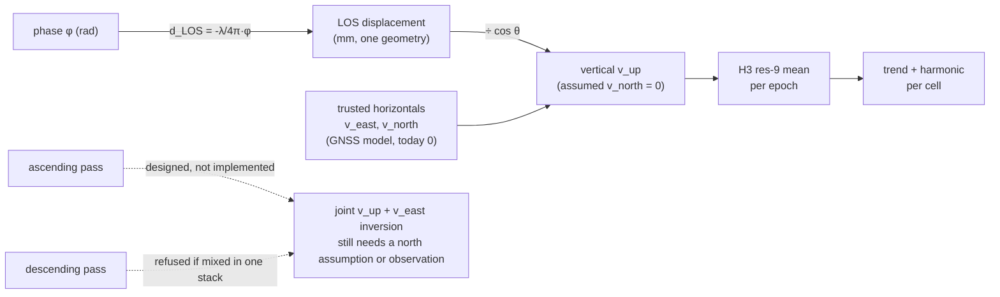
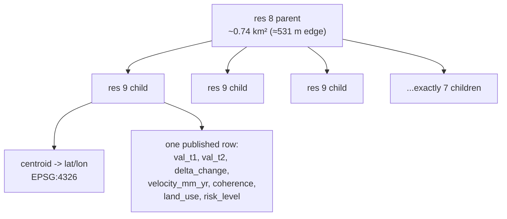
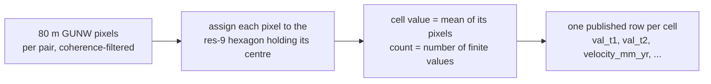

# Science guide — SAR to publishable displacement

This is the detailed scientific companion to the project README. It explains the physical
measurement, the time-series and identifiability gates, and the H3 spatial model. Acquisition and
processing mechanics live in `pipeline/`; field definitions are normative in
`src/domain/contracts.py`.

> **Evidence boundary.** Every committed artefact under `data/processed/` is synthetic
> (`product: "mock"`). The real-processing path has been exercised on synthetic HDF5 fixtures, not a
> downloaded granule. Worked constants are examples, not per-granule metadata or GNSS validation.

---

## 1. The physics in one paragraph

A radar satellite sends a pulse, receives the echo, and records **phase**. Phase is only meaningful
*differentially*: take the same ground patch from two passes 12 days apart, subtract the phases, and
the difference is proportional to how far the ground moved along the line of sight. NISAR is
**L-band** (λ ≈ 23.84 cm): the long wavelength keeps the signal coherent over vegetation and cities,
and one 2π cycle of phase — a *fringe* — spans ≈ 119 mm of line-of-sight motion. The fringe is the
**ambiguity interval, not the resolution**: phase is read as a continuous fraction of it, which is
why 0.09 of a fringe (≈ 11 mm along LOS, ≈ 13.8 mm vertical) is still a measurement, not a rounding
error. Because the measurement is
a *projection* along one look direction, a single pass cannot separate vertical from horizontal
motion; the pipeline solves for vertical while assuming the horizontal is zero, and says so in
`provenance`. Urban subsidence is then a time-series problem: fit a line plus an annual harmonic to
each H3 cell (the ~200 m hexagon of §4), publish the slope, and publish the harmonic beside it as a
fit result — since contract 1.1 it is a required grid field, `seasonal_amp_mm` (§3.3).


*The three cases on one symmetric ±425 mm/yr scale (chosen: the mock's Mexico City peak rounded up —
not a physical limit), drawn from the synthetic mock artefacts — Mexico City's bowl, Jakarta's
coastal edge, and Málaga essentially blank. That blankness **is** the finding: one honest scale,
published detection limit, no per-city auto-stretch.*

---

## 2. SAR and InSAR from first principles

*Read this section only if you will touch a number's arithmetic. Artefact consumers can start at the data contract:
nothing here is needed to render anything.*

Six conventions hold everywhere in this repo, and most confusion in InSAR comes from one of them
being silently different:

| Convention | This project | The failure it prevents |
|---|---|---|
| sign | **up / east / north positive**; subsidence is negative; positive LOS is **toward** the sensor, i.e. uplift (label renamed to match the arithmetic, O-08) | a flipped sign reads as uplift |
| units | displacement and `val_t*`/`delta_change` in **mm**, rates in **mm/yr**, volume in **m³/yr** | mm vs mm/yr confusion (why `delta_change` and `velocity_mm_yr` are separate fields) |
| angles | incidence θ from **nadir**, heading α **degrees clockwise from north** | conventions differ between ISCE2, MintPy and SNAP |
| time | years on a **365.25-day** year; dates ISO `YYYY-MM-DD` in UTC | a 365-day year biases every rate by 0.07 % |
| position | published in **EPSG:4326**, metric maths in the case's **UTM** zone | mixing degrees with metres in an area or gradient |
| nodata | **absent**, never 0 or a sentinel | Málaga's flat-but-real 0 mm/yr |

### 2.1 Side-looking geometry: range, azimuth, phase

A SAR antenna looks sideways, not down. Two coordinate axes follow from that:

- **range** — distance from the antenna; the echo's delay gives it, and the *phase* of the echo is
  what we exploit.
- **azimuth** — along-track; the platform's motion synthesises a long aperture, giving ~metre
  resolution in azimuth.

The **incidence angle** θ is measured from vertical (nadir). NISAR at θ ≈ 39° is a compromise:
steeper looks (small θ) raise `cos θ`, the vertical sensitivity, while shallower looks lower it *and*
add layover and shadow in cities. **The geometry used in every example here — θ = 39°, α = 192° — is
the documented example geometry, not a per-granule truth**: a real file carries its own incidence and
heading, and `process_case` reads them (or refuses) instead of assuming these numbers.

```
                    S  satellite
                   /
                  /   line of sight, length R
                 /    angle θ from the local vertical
                /
               /
- - - - - - - T - - - - - - - - - - - - - - - - - - - - - -   ground plane
              :
              :   local vertical (nadir), from the target
              v   true motion: mostly down ⇒ v_up < 0
```

The same geometry in the numbers this repo uses (θ = 39°, heading α = 192°):

```
u = [cosθ, -sinθ·cosα, -sinθ·sinα] = [0.777, +0.616, +0.131]   heading 192 (descending-like)
                                    [0.777, -0.616, -0.131]   heading  12 (ascending-like)
```

Note what changes and what does not: **the vertical component is `cos θ` and is heading-independent**.
Only the horizontal split flips. That single fact is the root of the ascending/descending problem in
§2.6.

> **One caveat on those horizontal signs.** The frozen pair `(−sinθ·cosα, −sinθ·sinα)` is cross-track
> only if `α` is the *look* azimuth. With `α` as the platform heading — clockwise from north, the
> convention this page states — and a right-looking antenna, the cross-track horizontal is
> `(+sinθ·cosα, −sinθ·sinα)`. The two differ **only in `u_east`** (`u_north` is unchanged), so no
> vertical number moves while `v_east = v_north = 0`. That is precisely why the convention is a
> recorded input (`--heading-convention platform|look`) and why it can only be *tested*, not argued,
> by supplying a horizontals model.

### 2.2 The interferogram: two passes, one number per pixel

An **interferogram** is formed from two co-registered complex images, `S₁` and `S₂`:

```
IFG = S₁ · conj(S₂) = |S₁||S₂| · exp(i·φ)          φ = φ₁ - φ₂   (wrapped, radians)
```

Two things fall out of one complex product:

| Quantity | Formula | Meaning in this project |
|---|---|---|
| phase `φ` | `arg(IFG)` | ground displacement along LOS (after unwrapping) |
| coherence `γ̂` | `\|E[IFG]\| / sqrt(E[\|S₁\|²]E[\|S₂\|²])` | how trustworthy that pixel's phase is, 0–1 |

Coherence is not decoration — it is the quality gate. A water surface changes every 12 days, so its
phase is uniform-random noise; masking on coherence removes it. That is why "water cells are absent"
is a *physical* statement, not a styling choice. The mechanism is **temporal decorrelation**: the
longer the gap between the two acquisitions, the more the surface has rearranged its scatterers —
fastest for water and vegetation, slowest for bare rock and stable roofs. It is therefore a property
of *both* the surface and the revisit interval, which is why coherence is only comparable within one
revisit interval (§2.4).

### 2.3 Phase → millimetres (the `λ/4π` scale)

Path length is counted twice (out and back), and one full cycle of phase is 2π:

```
d_LOS = -λ / (4π) · φ_unwrapped        [m],  default convention: positive = toward the sensor (see §2.6)
λ_L   ≈ 0.2384 m                        NISAR L-band, ~1.2575 GHz
```

> **The minus sign is the shipped default, not a law of nature.** It is labelled `toward-sensor`,
> and that label now matches the geometry: `project_to_los` puts `u_up = cos θ > 0` in front of the
> vertical, so a positive `d_LOS` is motion toward the sensor, which is uplift here (subsidence is
> negative). **O-08 was closed by renaming the label, not by changing the arithmetic**: the factor
> is still -1.0 and every default number is unchanged. `--los-sign away-from-sensor` is the +1.0
> flip and inverts every published vertical value. The selected sign is recorded in
> `meta.provenance`, and the convention stays unvalidated until `--validated-against` names a
> GNSS/levelling series or a published rate.

Every *L-band* phase-to-millimetre figure in **this document** derives from that one constant. The
pipeline itself does not hard-code it: `process_case` takes `wavelength_m` from the granule, else
`c/centerFrequency`, and 0.2384 m is a *warned* fallback — `nisar_gunw.py` refuses to assume L-band's
value when the metadata is missing. At θ = 39°:

| Quantity | LOS | Vertical (`/cos θ`) |
|---|---:|---:|
| 1 radian of phase | 18.97 mm | **24.41 mm** |
| one fringe (2π) | 119.2 mm | **153.4 mm** |

Reproduce it exactly (this is the command the pipeline documents):

```bash
./scripts/python.sh -c "import math; from pipeline.science import transforms as V; \
  print(round(float(V.vertical_from_los(0.2384/(4*math.pi)*1e3, 39, 192)), 2))"
# -> 24.41
```

The code that applies it is `nisar_gunw.phase_to_los_displacement_mm`, and its sign is a declared
input, not a hidden constant:

```python
# pipeline/ingest/nisar_gunw.py :: phase_to_los_displacement_mm (core lines)
output = (float(sign) * wavelength * 1000.0 / (4.0 * np.pi)) * phase
output[~np.isfinite(phase)] = np.nan   # NaN/inf is invalid input, never displacement
```

`sign` defaults to `-1.0`, which the CLI labels `toward-sensor`: positive `d_LOS` is motion toward
the sensor, so uplift is positive and subsidence negative — the same direction `project_to_los`
computes for a pure vertical field (`u_up = cos θ > 0`). `--los-sign away-from-sensor` applies
`+λ/4π·φ` and flips every vertical sign. The numerical examples below are algebraic round trips,
not validation of that label. The NaN mask is applied *after* the arithmetic on purpose —
`inf * 0` must not become a physical-looking `0 mm`.

**Why this scale matters for the demo.** Mexico City's mock configured peak, −420 mm/yr, moves
≈ −13.8 mm vertically in a 12-day pair — about **0.09 of a fringe**. A tenth of a fringe per pair is
why **one unwrapping cycle slip can swamp many pairs of signal**: at this example geometry it is
≈ 153 mm of vertical error, eleven times the pair displacement. This is a magnitude comparison,
not a claim that unwrapping always dominates every scene's expected error budget.

**Why L-band, and what it costs.** A longer wavelength buys *coherence*: L-band penetrates canopy and
dry soil better than C-band, so scatterers rearrange more slowly and a 12-day pair stays usable over
a vegetated or dusty city. The cost is *scale*: at λ ≈ 5.6 cm, C-band would give ≈ 4.5 mm per radian
instead of 19 mm, i.e. roughly four times finer — but its coherence over the same surface is worse,
i.e. more radians of noise to divide, so the finer scale is not obviously a win. For motion of tens
of cm/yr the trade is clearly worth it; for millimetre-level infrastructure monitoring it would not
be. This is a wavelength choice, not a processing preference, and it is why the `λ/4π` constant is in
`provenance`.

### 2.4 Coherence, looks, and the debias correction

Multi-looking averages `L` independent **looks** — one look is one independent resolution cell — which
biases the sample coherence upward:

```
E[γ̂²] = γ² + (1 - γ²)/L      =>      γ_corr = sqrt((L·γ̂² - 1) / (L - 1))
```

`transforms.coherence_bias_correction` implements the inverse. Three deliberate choices:

- **NaN outside the domain.** For `γ̂ ≤ 1/√L` the radicand is ≤ 0: no real-valued unbiased estimate
  exists. Clamping to 0 would fabricate "perfectly decorrelated"; clamping to `1/√L` would fabricate
  a measurement. NaN lets the `coherence_min` filter drop the cell, so it is *absent*, not zero.
- **It always lowers the number** (`γ_corr < γ̂` for all `γ̂ < 1`). A "corrected" coherence that rose
  is a bug. The mechanism: with `L` looks the sum of `L` random-phase contributions rarely has
  near-zero magnitude, so sample coherence is biased *up*; subtracting that `L`-dependent floor is
  why an unbiased estimate can only fall relative to the raw one.
- **Never compare across sensors.** 12-day coherence (NISAR, and `opera-disp-s1`) is not 6-day
  coherence (`hyp3-s1`, `egms`); the contract encodes this by making thresholds a property of a
  `(sensor, product)` profile, not a
  global constant.

```python
from pipeline.science import transforms as V

gamma_hat = [0.80, 0.35, 0.20]
looks = 4

# 1/sqrt(4) = 0.5: only 0.80 survives the domain test, and the correction lowers it
print(V.coherence_bias_correction(gamma_hat, looks))
# -> [0.7211  nan  nan]
```


*One panel per case on a shared 0–1 scale. Cells below `coherence_min` are **absent**, not drawn as
zero — the **white** gaps are that filter (water, specular, low-look edge). The dark end of the scale
is empty because no surviving cell is below γ ≈ 0.35: on this figure, "dark" would mean
low-but-published, and "white" means excluded.*

### 2.5 Unwrapping, connected components, and what can go wrong

`arg(IFG)` is only defined modulo 2π. **Unwrapping** integrates the phase gradient across the image
to recover a continuous field, and it is where real InSAR fails:

| Failure | Signature | Effect here |
|---|---|---|
| cycle slip / unwrapping error | integer multiple of 2π in a patch | 153 mm vertical jumps in the example geometry — a first-order risk |
| decorrelation | low `γ̂` | cell dropped by `coherence_min` |
| troposphere (wet delay) | broad, weather-shaped signal | correlated in time, so *not* averaged away by more dates |
| orbit error | long-wavelength ramp | needs baseline/ramp correction (designed, not implemented) |
| DEM error | phase proportional to baseline | designed, not implemented |

NISAR GUNW (geocoded unwrapped interferogram, §1.2 of the pipeline internals) ships `connectedComponents` (uint32) so
disconnected islands are *visible* rather than silently offset; the reader requires and summarises the
labels (`nisar_gunw.summary()["connected_components"]`), but no filter consumes them yet. README §13
lists the remaining error sources; their expected ordering is scene- and stack-dependent, so the
single-slip comparison above must not be promoted into a universal error-budget ranking.

### 2.6 LOS projection and the single-geometry ambiguity

The forward model (this is the frozen formula, implemented in `transforms.los_unit_vector` /
`project_to_los`):

```
d_LOS = u · [v_up, v_east, v_north]ᵀ
u     = [cosθ, -sinθ·cosα, -sinθ·sinα]
```

Inverting for vertical, given *trusted* horizontals:

```
v_up = (d_LOS - u_east·v_east - u_north·v_north) / u_up
     = d_LOS/cosθ + tanθ·(cosα·v_east + sinα·v_north)
```

One equation, three unknowns. The pipeline therefore **assumes** `v_north ≈ 0`, and the residual
error of that assumption is exactly

```
error = tanθ · sinα · (v_north - assumed_v_north)      ≈ -0.17·v_north at θ=39°, α=192°
```

while the coefficient on `v_east` in the inversion reaches `tanθ·|cosα| ≈ 0.79` (the raw LOS
sensitivity is `sinθ·|cosα| ≈ 0.62`) — it does **not** cancel. Hence:

- **Ascending + descending would give two equations for three unknowns** (`v_north` stays
  undetermined either way). That inversion is *designed, not implemented*. The pipeline instead
  **refuses** a stack that mixes flight directions (`_check_stack_identity` → `TrackMismatchError`),
  even though the download plan already derives track and direction from the filenames (not frame)
  and could in principle pair them.
- **Geometry must be a scalar, not a grid.** Incidence and heading are probed by
  `process_case._probe_granule_metadata`; if the only value available is a per-pixel grid, that is a
  `GeometryRequiredError` — averaging θ would silently redefine `cos θ`, which scales every
  millimetre of everything downstream.
- **The sign/azimuth convention is recorded, not validated.** `--los-sign {toward-sensor,
  away-from-sensor}` (default `toward-sensor`, i.e. `d_LOS = -λ/4π·φ`: positive = toward the sensor =
  uplift; `away-from-sensor` is the +λ/4π flip) and `--heading-convention
  {platform, look}` change arithmetic *and* enter `provenance`; `meta.provenance.method` carries the
  sentence *"NOT yet validated against GNSS"* until **any of the four convention flags** is passed
  (`--los-sign`, `--heading-convention`, `--method-note`, `--validated-against` — even a plain method
  note removes it). The flags record the convention; they do not validate it. `--validated-against`
  records a GNSS/levelling **or published-rate** check, and the runbook gates publication on that
  hedge being gone. Mock artefacts never carry it: their method says *"Synthetic field, no
  observation"*. **O-08 is why the default is named `toward-sensor`:** the label had said
  `away-from-sensor` while the factor -1.0 fed to `project_to_los`-compatible geometry made uplift
  positive. Renaming fixed the contradiction; a test suite asserts the signs from the physics
  (`tests/test_process_case_convention.py` §9, `tests/test_science_transforms.py`).
- **The convention is invisible under today's defaults** — the `u_east`-only caveat of §2.1: `u_up =
  cos θ` does not depend on heading, and the horizontal terms vanish when `v_east = v_north = 0`, so
  platform-vs-look heading produces identical numbers on the shipped path. Only a supplied horizontals
  model makes the convention observable.



```python
from pipeline.science import transforms as V

# forward: a purely vertical 10 mm motion, seen from θ=39°, α=192°
los = V.project_to_los(vertical_mm=-10.0, incidence_deg=39, heading_deg=192)
# -> -7.77 mm  (u_up = cos 39° = 0.777)

# inverse under the shipped assumption
back = V.vertical_from_los(los, incidence_deg=39, heading_deg=192, assume_vnorth=0.0)
# -> -10.0 mm
```

### 2.7 A worked example: one pair, one cell, one published number

The chain is easier to trust when one number is followed end to end. Take a cell at Mexico City's
configured peak rate, −420 mm/yr, in one 12-day pair, at θ = 39°, α = 192°:

| Step | Value | Arithmetic |
|---|---:|---|
| vertical motion in one pair | −13.80 mm | `−420 × 12/365.25` |
| project onto LOS | −10.72 mm | `× cos 39° = 0.777` |
| interferometric phase | **+0.565 rad** | `φ = −d_LOS · 4π/λ` |
| fraction of a fringe | **0.09** | `φ / 2π` |
| annualised **vertical** rate | −420 mm/yr | `−13.80 × 365.25/12` |
| risk band | `critico` | `\|v\| ≥ 25 mm/yr` |

Every LOS value is negative because the ground subsided: under the default `toward-sensor` label a
positive `d_LOS` is uplift, so downward motion is negative and the phase brings the sign back
(`φ = +0.565 rad` with `d_LOS = -10.72 mm`). That is the direction of the frozen `u` in §2.6
(`u_up = cos 39° = 0.777 > 0`), not a separate assumption.

The same nine hundredths of a fringe motivates the unwrapping warning: one cycle slip is 2π =
153.4 mm vertical (§2.3), eleven times this example pair's motion. It demonstrates the potential
magnitude of a slip, not the expected error contribution relative to noise.

```python
import math
from pipeline.science import transforms as V

lam, theta, heading = 0.2384, 39, 192
per_pair_vertical = -420.0 * 12 / 365.25          # mm in one 12-day pair
los = float(V.project_to_los(per_pair_vertical, theta, heading))
phase = -los / 1000.0 * (4 * math.pi) / lam        # mm -> m before the 4*pi/lambda scale

print(round(per_pair_vertical, 2), round(los, 2), round(phase, 4), round(phase / (2 * math.pi), 4))
# -> -13.8 -10.72 0.5653 0.09

# and back: the inverse must return the number we started from
print(round(float(V.vertical_from_los(-phase * lam / (4 * math.pi) * 1000, theta, heading)), 3))
# -> -13.799
```

What the pipeline adds on top of this arithmetic: the H3 cell value is the **mean of its pixels**, the
annual rate is the **fitted slope over the stack's epochs** (62 in the mock; a 12-file plan chains 13
— §3.1), and the sign belongs to the declared `--los-sign` convention rather than to the formula above.

---

## 3. From pairs to a time series

A stack of pairs becomes one trajectory per H3 cell. The whole job here is to separate a **rate**
from a **cycle** without lying about either — and to know when the data cannot tell them apart.

### 3.1 Stacking: cumulative displacement

Each granule `(t_i, t_{i+1})` gives a *difference*. A series is formed by chaining differences to a
reference epoch, so the first date is exactly 0 mm (the cells these trajectories belong to are
defined in §4; their published fields in the data contract):

```
d(t_k) = Σ_{i<k} d_LOS(t_i → t_{i+1})        d(t_1) = 0
```

A granule carries **four** timestamps — reference start/end and secondary start/end. Three different
"epoch" counts follow, and they are not interchangeable: the advertised window (`date_range`) is built
from **reference starts only**, because the secondary stamp belongs to an *earlier* epoch and must not
extend it (decision D-15); `n_epochs` counts every distinct acquisition day the stack carries,
reference *and* secondary; and `connected_epochs` is the longest chained run — what a download would
actually give. Using both stamps for the window made it disagree with the sampled granule ids.

Referencing is **spatial**, not temporal: the pixel nearest to the case's `reference_point` (in
`config/study_cases.yaml`) is treated as stable and subtracted from every epoch, and `process_case`
asserts that epoch 0 is 0 mm to 1e-9. A reference pixel more than 1000 m from the configured point warns
(rather than silently moving the datum), and a reference date that is not already an epoch is a
refusal — "stack is not a connected network". Other connectivity rules: a pair whose secondary
precedes its reference is refused (the sign would invert), duplicate pairs warn, off-revisit gaps
warn, and fewer than `MIN_FIT_POINTS = 4` epochs is a refusal.

Consequences visible in the artefacts: `val_t1` is the first date (0 by construction), `val_t2` the
last, and `delta_change = val_t2 - val_t1` — **cumulative millimetres**, not a rate. The rate lives in
`velocity_mm_yr` and comes from the fit in §3.2. The contract separates them because one field cannot
honestly be both.

**Pair count is not epoch count.** A connected chain of `k` pairs yields `k + 1` epochs.
The availability preview and the contiguous download run are different selections; their rules live
in `pipeline/ingest/02_search_download.py`. The processor requires a connected network and at least
`MIN_FIT_POINTS = 4` epochs, regardless of how the chain was selected.

### 3.2 The time-series model, and why harmonics are *centred*

Fitted per cell (`transforms.harmonic_fit`), with the step terms deliberately omitted:

```
v(t) = v₀ + ṫ·t + Σₖ [ Aₖ·cos(2πkt/T) + Bₖ·sin(2πkt/T) ]        implemented
     + Σⱼ Δvⱼ·H(t - tⱼ)                                          designed, not implemented
```

(`H` is the Heaviside step: 0 before the step date `tⱼ`, 1 after. Step detection is *not*
implemented — see §3.3.)

Design matrix for `K = 1`, `T = 1 yr`:

```
[ 1 , t , cos(2πt) , sin(2πt) ]        ->  least squares  ->  [v₀, ṫ, A₁, B₁]
```

- `ṫ` (the `t` coefficient) is published as `velocity_mm_yr`. This is what "fitted trend" means in
  the contract (`HarmonicFit.trend_mm_yr` is the in-memory name of that same published field). The
  mock fits a basis that contains the harmonic its series was generated from, so the fitted slope
  reproduces the generating velocity to floating-point precision — the configured field **plus** each
  cell's `noise_mm_yr` draw (next paragraph), never the smooth config value itself. That the column
  is that recovered number, not a copy of a config entry, is what makes `velocity_mm_yr` a fit.
- `A_seasonal = hypot(A₁, B₁)` is the recoverable/elastic amplitude — computed, and **gated** (§3.3).
- The annual harmonic sits *inside* the basis, so a 12-day-sampled subsiding city cannot label its
  seasonal swing as a trend. That collinearity is the entire point of step P6 (the pipeline stages) — the
  harmonic-versus-trend separation.

**Why "recovers to floating-point precision" is not contradicted by "ill-conditioned" below.** Same
basis, different data. The mock's series *is* the generating basis: one draw per cell on the secular
velocity (`noise_mm_yr` — a slope offset, not per-epoch scatter), then the ramp plus the centred
harmonic — no temporal noise to propagate, so `pinv` recovers the slope exactly. That exactness is a
property of a noise-free field, not of an easy design: the published 2-year design conditions at 4.12
(`meta.stats.design_condition`, limit 30), and a real stack over the same span would carry the
per-epoch scatter this mock omits. On the old 132-day window a real stack conditioned at ≈ 67 (§3.3):
there the slope survived and the amplitude did not.

**Harmonic centring** is the subtle part, and it is where this repo already had a bug. How much it
buys is a property of the window, not of the code: the two anchorings agree only when the last epoch
falls at a whole number of cycles after the first. The algebra is window-independent —

```
anchored at t=0:      d(t) = v·t + A·cos(2πt)          d(0) = +A,  d(t_end) = +A·cos(2πt_end)
                      => each endpoint carries whatever phase the window's span leaves it at
centred on c = t_end/2:
                      d(t) = v·t + A·[cos(2π(t-c)) - cos(2πc)]
                      => d(0) and d(t_end) carry the SAME seasonal offset (offset = 0)
```

ASCII picture of the **current 2-year window** (secular trend downwards, 2.00 annual cycles). The
seasonal term is drawn far larger than life: the real amplitudes are 1.5 / 12.0 / 3.5 mm against
176 / 83 / 2.7 mm of secular motion across the whole window (Mexico City / Jakarta / Málaga, from
the published AOI row: `trend_mm_yr` × the 2.004 yr span). Because 2.004 cycles leave the last epoch
at almost the same phase as the first, an anchored and a centred harmonic put nearly equal offsets
at the two ends, so the two anchorings differ only marginally in `delta_change` here:

```
   mm
   0 |*
     | *                                  d(t), centred harmonic
     |  *  ~.        ~.        ~.         2.00 annual cycles
     |   *    `~._  .'  `~._  .'  `~._    both endpoints at 0 seasonal offset
     |    *        ``       ``       ```
     |     *
     |      *                              secular trend (vertical scale not to scale)
     +----------------------------------  days (0 → 732)
```

The construction is kept because it is the general fix, and the window that exposed the bug was the
**old 132-day window** (0.36 cycles), where a harmonic anchored at `t = 0` is not a cycle — it is a
*monotone slice* of one. That window is kept below as history: it is the shape the gate calibration
in §3.3 is tuned against.

```
   0 |*                                   d(t), centred harmonic, 132-day window
     | *                                  both endpoints at 0 seasonal offset
     |  *      ******
     |   *   ***     ***        <-- mid-window bulge (~0.58·A), then return
     |    * **         **
     |     *              **
 -20 |      *               ***
     +----------------------------------  days (0 → 132)
```

Symmetrically, an **anchored** harmonic over that short window looked like extra subsidence — the
endpoint completes barely a third of a period, so its cosine has not come back up:

```
   0 |**                                  d(t), harmonic anchored at t=0, 132-day window
     |  ***
     |     ***
     |        ****
     |            *****
 -20 |                 ***********       <-- looks like "extra subsidence"
     +----------------------------------  days (0 → 132)
```

Numbers from the fix, measured on that 132-day window (precise digits: decision D-02;
the mock hand-off note rounds them to "2–8×" and never states the cell count): before centring,
`delta_change/T` overstated the trend by **2.1–7.9×** and disagreed in *sign* on up to **601 cells**
— the map rose where the slider fell.
These were measured on 2026-11-14 against the pre-fix code and no committed test reproduces them
(reproducing means reverting `cumulative_series`), so treat them as a recorded measurement, not a
guarded number. After centring — on the current 2-year mock as on that old window —
`delta_change/T ÷ velocity_mm_yr = 1.000` for every published cell and there are **zero** sign
disagreements. The code that does it:

```python
# pipeline/mock/model.py :: cumulative_series (lines elided with ...)
first = dt.date.fromisoformat(dates[0])
t_days = np.array([(dt.date.fromisoformat(d) - first).days for d in dates], dtype=float)
t_years = t_days / SECONDS_PER_YEAR
...
season_centre_days = float(t_days[-1]) / 2.0 if t_days.size else 0.0   # c = window midpoint
anchor = np.cos(2.0 * np.pi * season_centre_days / SEASONAL_PERIOD_DAYS)
season_phase = 2.0 * np.pi * (t_days - season_centre_days) / SEASONAL_PERIOD_DAYS
seasonal = case.field.seasonal_amplitude_mm * (np.cos(season_phase) - anchor)
series = velocity[:, None] * t_years[None, :] + seasonal[None, :]
```

### 3.3 Identifiability: when a seasonal amplitude is *not publishable*

> **2026-11-15 — the demo window is two years, not 132 days, and the gates now pass.** The
> short-window failure this section is built around is still the reason contract 1.1's seasonal fields
> are a *fit result* rather than typed constants (O-05 in the decisions): on the
> 2-year window `annual_coverage` (2.004) and the design condition (4.12) both clear their gates with
> margin, so `seasonal_amp_mm`, `ratio_R` and `regime` are published. The 0.36 yr figures below are the
> historical 132-day measurement, kept because they are what the gates are calibrated against; each is
> labelled as such rather than presented as current behaviour.

A good `r²` does not mean the harmonic was measured. On the **old 132-day window** the annual pair was
nearly collinear with `[1, t]`; the fit could report `r² ≈ 0.95` and still have an amplitude that was
a fitted artefact. The **current 2-year window** does not inherit that ambiguity — `annual_coverage`
is 2.004 and the design conditions at 4.12 (one harmonic: 4.02) — which is the point: identifiability
is a property of the design matrix, not of `r²`. The module encodes two gates:

| Gate | Constant | Value | What it means |
|---|---|---:|---|
| coverage | `MIN_SEASONAL_COVERAGE_PER_HARMONIC` | 0.75 | harmonic `k` needs ≥ `0.75·k` years of span; annual → 0.75 yr, second → 1.5 yr |
| conditioning | `MAX_DESIGN_CONDITION` | 30 | condition number of the **column-normalised** design matrix |

Measured condition numbers: well-identified designs sit at 4–12 (the committed 2-year mock at 4.12);
the degenerate cases sit at 67 (the old 132 d window, one harmonic), 1.0e3 (132 d, two harmonics)
and 5.5e4 (dates clustered in five weeks). 30 sits in the empty band: 2.5× above the worst
well-identified design (30/12) and 2.2× below the mildest degenerate one (67/30).

What the number means: the condition number of a design matrix bounds how much a small error in the
data can be amplified into the fitted coefficients. When `[1, t]` and a cosine observed over a third
of its cycle are nearly parallel, the fit can trade one against the other, and **both** coefficients
absorb the error — but not equally. On the old 132 d of 12 dates the slope's standard error rose from
≈ 2.5 mm/yr per mm of noise (pure line) to ≈ 37 with one harmonic and ≈ 518 with two, while the
amplitude's variance inflation is comparable from the start. On such a window one harmonic is
tolerable for the trend and fatal for the amplitude; a second harmonic is fatal for both. That is why
the gate withholds the amplitude on such a window and keeps the trend.

Below the gate the **behaviour is warn, not raise**:

```python
fit = V.harmonic_fit(t_years, disp_mm, period_years=1.0, n_harmonics=1)

# committed 2-year mock, 62 dates, 2024-11-10 -> 2026-11-12
fit.trend_mm_yr                 # published (identified by the span)
fit.seasonal_identifiable       # True
fit.warnings                    # ()
fit.annual_coverage             # 2.004  (gate: MIN_SEASONAL_COVERAGE_PER_HARMONIC per harmonic)
fit.design_condition            # 4.02 with one harmonic; 4.12 for the 2-harmonic design the mock fits
fit.regime                      # a fit result: "inelastic" (Mexico City, Jakarta), "elastic" (Malaga)

# the old 132-day window, kept because it is what the gates are calibrated against:
#   seasonal_identifiable False, annual_coverage 0.36, design_condition ~67,
#   warnings ('seasonal harmonic 1 ... do not publish seasonal_amp_mm ...',),
#   regime forced to "transitional" when not identifiable
```

Why warn and not raise: `process_case.py` catches `ValueError` and drops the cell, so raising would
silently empty the whole grid *and* throw away `velocity_mm_yr`, the one number the contract needs.
The trend survives a short window far better than the amplitude (on the old 132 d window the slope
standard error was ≈ 37 mm/yr per mm of noise with one harmonic, versus ≈ 518 mm/yr with two).

The honest harmonic order is chosen by a ladder, not by taste (`process_case._harmonic_order`):

| Span | Epochs | Harmonics fitted |
|---|---:|---|
| ≥ 1.5 yr | ≥ 6 | 2 |
| ≥ 0.75 yr | ≥ 4 | 1 |
| otherwise | any | 0 (pure linear fit) |

A ~0.36 yr window therefore gets **zero** harmonics from the real path (`_harmonic_order` returns 0
below the 0.75 yr annual gate), i.e. a pure linear fit — so on the old 132-day demo window the
coverage gate never fired. It mattered historically: while the ladder cut at 0.5 yr, a 0.5–0.75 yr
stack was fitted one harmonic and the gate then marked its amplitude unpublishable. With the cut
aligned to the coverage constant the ladder cannot request what that gate rejects by span, so the
remaining span-shaped rejection is conditioning (dates clustered in a short sub-window). The demo
stack now spans 2 years (62 epochs, 732 d, 2.004 cycles), where `_harmonic_order` asks for the
2-harmonic order and both gates pass (`meta.stats.seasonal_n_harmonics` is 2), so the fitted
amplitude is published (O-05). Fitting and publishing are still separate decisions.

A stack below the annual gate takes the **not-fitted** path instead: `harmonic_order` returns `0`,
the design is `[1, t]` alone, and contract 1.1 still requires the seasonal triple, so the grid
publishes `seasonal_amp_mm = 0.0` (**not fitted**, never "no seasonality"), `ratio_R = null` and
`regime = "transitional"` (§3.4). At the declared 12-day revisit that gate is ≈274 d of cover
(0.75 × 365.25 d) — roughly 23 pairs — so this is the corner a short stack lands in, not a
hypothetical.

> **Contract v1.1 publishes the seasonal fields; v1.0 did not.** In v1.0 `seasonal_amp_mm` existed
> only on `HarmonicFit` (a diagnostic for a test or a notebook) and was dropped at the artefact
> boundary: `GRID_FIELDS` had no such column, so no `meta.json`, parquet column or UI card carried it.
> The "do not publish `seasonal_amp_mm`" line in `limitations` was written for that boundary — a
> guard against a field, not a description of one that existed. `regime` was dropped for the same
> reason (§3.4). Contract **v1.1** (`SCHEMA_VERSION "1.1"`, `CONTRACT_REVISION 2`) makes grid
> `seasonal_amp_mm`/`ratio_R`/`regime`, timeseries `trend_mm_yr`/`seasonal_mm` and stats
> `median_seasonal_amp_mm`/`median_ratio_R`/`dominant_regime` **required**, and they ship as a **fit
> result** from the same `harmonic_fit` the real path uses — not a typed constant. That is only
> honest because the window moved to 2 years, where the gates above pass. Either way a consumer must
> check `meta.schema_version` before assuming a shape. <!-- prohibition-historical: quotes the v1.0 `limitations` line and explains why it existed then (no grid field to publish); it is not a claim about the 1.1 artefacts, which do publish the fitted amplitude -->

### 3.4 Regime index (computed, and published since v1.1)

*`R` and `regime` are computed by `classify_regime` and, since contract v1.1, **published**: `ratio_R`
and `regime` are required grid columns, and `median_ratio_R` / `dominant_regime` are required stats
(see `GRID_FIELDS`, the data contract). Under v1.0 they were computed and
dropped, because the 132-day window could not measure the denominator (§3.3). The app still *bands*
`risk_level`, and the colour itself is `velocity_mm_yr` (the mock handoff).*

```
R = |ṫ| / A_seasonal
R > 2        -> "inelastic"     (secular dominates: permanent, non-recoverable)
1 ≤ R ≤ 2    -> "transitional"
R < 1        -> "elastic"       (seasonal dominates: recoverable)
```

**A stack that fits no harmonic publishes "not fitted", not a number.** When `harmonic_order` returns
`0` the model has no seasonal column at all, and the three required fields carry what the design can
actually support rather than a value the fit cannot certify:

- `seasonal_amp_mm = 0.0`. The zero is the coefficient of an absent basis column: it says **"not
  fitted"**, not "we measured no seasonality". Reading it as a measurement would turn the absence of
  a seasonal *term* into a claim about the ground — the same category error as trusting `r² ≈ 0.95`
  for an amplitude on a window that cannot separate the annual pair from `[1, t]` (§3.3).
- `ratio_R = null`. The column is required, but `R = |ṫ| / 0` is undefined — not small and not large.
  `inf` is not a publishable float (it breaks the finite, non-negative rule the column carries
  everywhere else) and a sentinel such as `1e9` would be read as "extremely inelastic" by a person
  and by `classify_regime`. Null is the only honest value, and it travels with its reason:
  `meta.stats.median_ratio_R` is JSON `null` when no cell fitted a harmonic, and `meta.limitations`
  states that the seasonal term was not fitted.
- `regime = "transitional"`. `classify_regime`'s existing rule — `A_seasonal == 0` with a non-zero
  trend ⇒ `"inelastic"`, `R = ∞` — is right for a fit that *resolved* a near-zero amplitude: the
  secular term really does dominate a seasonal one the fit could see. It is vacuous for a fit that
  never had a seasonal column, where there is no denominator to dominate. So `harmonic_fit` with
  `n_harmonics == 0` returns `"transitional"`, this module's existing spelling for "the ratio carries
  no regime information" — the same choice it makes whenever `seasonal_identifiable` is `False`.

This is the physical thesis of the three cities: Mexico City's lacustrine clay is inelastic, Málaga's
karst is elastic. Under v1.0 `R` was **not published**: `transforms.classify_regime` computed it and
`HarmonicFit.regime` carried it, but no contract field transported it — over a 0.36 yr window the
denominator was not measurable. That was a property of the window, not of the quantity: on the 2-year
window `seasonal_amp_mm` is identifiable (§3.3), so v1.1 transports the ratio as `ratio_R` and the
label as `regime`. What the app *bands* is still `risk_level` (the colour itself is
`velocity_mm_yr`, the mock handoff), and a band is a frozen velocity threshold, not a regime.

**What the split means physically.** Subsidence in these cities is **interbed compaction**: pumping
lowers the hydraulic head in a confined aquifer, the fine-grained beds inside it drain slowly, and
the surface follows them down. Where those beds are clay, most of the compaction is **inelastic** —
the grains rearrange and the storage is lost for good (Mexico City). Where the aquifer is karst or
clean sand, much of the movement is **elastic** and returns when the head recovers (Málaga). That is
the thesis: compressibility helps control the *rate and recoverability*, while pumping-driven head
change supplies the forcing. The pipeline only measures the surface; the hydrological link is
**computed as a volume on the real path** (the
committed mock artefacts do not carry it) —
`transforms.velocity_metrics` computes `dV/dt = Σ v_up·A/1000` and `storage_loss_m3_yr = −dV/dt`, and
the per-aquifer skeletal storage coefficient `S_skv = Δb/(b₀·Δh)` would need head measurements this
project does not have.

### 3.5 Detection limit: the null result *is* the result

Málaga's median is −1.3 mm/yr. Publishing "no significant motion" without a bound is a claim without
content, so the contract *requires* `stats.detection_limit_mm_yr` whenever
`|median_velocity_mm_yr| < 5`:

```
σ_ṫ = σ/T · sqrt(12·(n-1) / (n·(n+1)))        (OLS slope standard error, n equally spaced epochs)
detection_limit = n_sigma · σ_ṫ               n_sigma = 2 (~95%)

n_epochs=None -> n = 2  =>  σ·sqrt(2)/T        (worst case: a two-date difference over the span)
```

σ is the per-epoch residual scatter of one cell's displacement about the **fitted model** — line plus
any fitted harmonic (mm); it is the same quantity `velocity_noise_mm` names in the code below.

Assumptions stated because the number depends on them: white noise (no temporal correlation), evenly
spaced epochs, straight-line trend. Real error is larger because atmosphere/orbit errors are
*correlated*, so the result is a **lower bound** and must be phrased "we detect no motion above
X mm/yr" — never as a measurement precision.

**What is actually published, and what would be computed.** The committed Málaga artefact carries
`1.5 mm/yr` because `config/study_cases.yaml` *declares* it (`detection_limit_mm_yr: 1.5`) and the
mock copies the constant. The formula above, applied to an **assumed** σ = 1.2 mm over the current
2.004 yr span, gives ≈ 0.52 mm/yr with the 62 published epochs and ≈ 1.69 mm/yr with the two-epoch
default (on the old 0.3614 yr window the same σ gave ≈ 6.1 mm/yr with 12 epochs and ≈ 9.4 mm/yr with
two — the window this section was written for). That 1.2 is a
*placeholder*, not a measurement: it is Málaga's `noise_mm_yr` borrowed from `config/study_cases.yaml`,
whose unit is a noise **velocity** (mm/yr), not a per-epoch displacement scatter — and the mock's own
residual about the fitted model is ≈ 2.5e-10 mm only because the CSV stores 9 decimals — in memory
the fit is exact (§3.2), so that residual says nothing about per-epoch scatter. So the formula is a
sanity check of the shape of the bound, not this stack's own number. The declared 1.5 is a **recorded
decision**, not an output of that arithmetic — it sits between the
current window's 0.52 and 1.69 and below the old window's 6.1 and 9.4. Only the real
`process_case.py` path computes the bound, and that path has never run on a granule.

```python
from pipeline.science import transforms as V

V.detection_limit_mm_yr(velocity_noise_mm=1.2, span_years=2.0041)          # two-epoch bound -> 1.69
V.detection_limit_mm_yr(velocity_noise_mm=1.2, span_years=2.0041, n_epochs=62)   # -> 0.52
# more epochs buy 1/sqrt(n) only: the span, not the count, sets the floor
# (the old 0.3614 yr window: 9.39 two-epoch, 6.11 with 12 epochs)
```


*Cumulative displacement since the first acquisition, with Málaga's detection floor shaded
(±1.5 mm/yr expressed as ±3.0 mm over the 732-day window: 1.5 × 732/365.25). Every series starts at
exactly 0 mm because it is referenced to the first epoch. The seasonal swing shows up as two annual
cycles in the Málaga and (weakly) Jakarta series. Mexico City's configured trend dominates its small
seasonal term over this window, so its series is monotonic; monotonicity alone would **not** prove
absence of a seasonal component. The contrast is a property of this synthetic model, not a measured
regime.*

### 3.6 Helpers outside the published artefacts

| Function | Formula | Status |
|---|---|---|
| `robust_zscore` | `z = (x − median)/(1.4826·MAD)` along time; NaN if MAD = 0 | used by change detection, not published |
| `detect_change` | keep a date if it fires in `m` of `n` consecutive dates (`"2of3"`) — a *subset* of raw flags | implemented, gated on a real stack |

Neither headline step is a helper: the aggregation (`h3_aggregate`) is P8 and covered in §4.3, and
`velocity_metrics` is P7 — the real path publishes its output as `meta.stats` (the percentiles plus
`compaction_volume_m3_yr` / `storage_loss_m3_yr`; the committed mock `meta.stats` carries the
percentiles only, §3.4).

---

## 4. Spatial discretisation: H3

The measurement is continuous and the product is discrete. H3 resolution 9 is where the two meet,
and it decides what "a cell's displacement" even means.

### 4.1 What H3 is

H3 is Uber's hierarchical hexagonal grid over the sphere. A cell is addressed by a 64-bit index whose
string form identifies the resolution, e.g. `8928308280fffff`. Resolution 9 is the project's working
grid: at city scale its ~200 m edge is 2–3 GUNW pixels, so it averages away single-pixel
unwrapping noise while staying far finer than the question the product asks ("how fast is this
neighbourhood sinking?").

| Quantity | Res 9 value | Note |
|---|---|---|
| edge length | ≈ 200 m (average 200.8 m) | comparable to 2–3 GUNW pixels |
| area | ≈ 0.105 km² average | individual cells vary with latitude (0.122 km² for a res-9 cell in the CDMX grid); a 0.105 km² hexagon is ~324 m across as a square — do not conflate the two |
| parent (res 8) | 7 children per parent | exact 1:7 index relationship, not exact polygon containment |

Why hexagons instead of a lat/lon raster: a hexagon has six **edge-sharing** neighbours (five at the
twelve pentagons, which a city grid never touches), so there is no diagonal anisotropy; cell areas
vary far less with latitude than a degree grid, and parent/child **indexing** is exact — which is
what makes `h3_aggregate` a one-liner instead of an index-resampling problem. The child polygons
are not exact geometric partitions of the parent, and spacing is near- but not perfectly uniform.

How pixels become cell values — the group-by, the per-cell counts and why a cell is never "the pixel
at its centre" — is §4.3.



### 4.2 Enumerating the AOI

On the **real** path the measurement domain is a QGIS-traced ring (`config/aoi/{case}.geojson`), not
a rectangle — a rectangle would put open water and desert into coastal cases. The **mock** uses the
ring's bbox envelope ∩ a synthetic coverage ellipse instead (see the funnel below), because its job
is to exercise the schema, not to footprint a city. Two distinct chains — do not implement one and
label it the other:

```
REAL  config/aoi/{case}.geojson ring (EPSG:4326)
        -> h3.polygon_to_cells(LatLngPoly(ring), res=9)      the measurement domain
        -> keep pixel coherence >= coherence_min             (per pair, per pixel, before averaging)
        -> per-pixel H3 mean per epoch (target == source == 9)
        -> published cell set + coverage fraction vs the ring's own cell count

MOCK  config/aoi/{case}.geojson -> bbox envelope
        -> h3.polygon_to_cells(bbox, res=9)                  candidates (centroid in bbox)
        -> keep centroid inside bbox AND the synthetic coverage ellipse
        -> keep modelled coherence >= coherence_min
        -> published cell set
```

The ellipse is a **mock-only** parameter: the string does not appear in `process_case.py`, and the
real path never clips to one.

`config/study_cases.yaml` owns each case's bbox, projected CRS, reference point, and model
parameters; `config/aoi/*.geojson` owns the ring. Read those files for current values rather than
copying a case-configuration ledger into this guide.

Metric maths (areas, ellipse radii, gradient spacing) happens in the UTM zone; artefacts are published
in `EPSG:4326` with the CRS declared **per feature**, so a consumer never guesses.

**Four different cell sets are easy to confuse.** The ring, footprint, published grid,
and published cells inside the ring answer different questions. Treat them as a funnel, not as
contradictory counts:

1. **Ring cells** — what `pipeline/aoi.py --all` reports: every res-9 cell whose centre falls inside
the AOI polygon (`h3.polygon_to_cells(LatLngPoly(ring))`).
2. **Candidates** — the mock's measurement domain is the ring's **bbox envelope** ∩ the coverage
   ellipse, counting cells by centroid. The synthetic ellipse can extend beyond the municipal ring.
3. **Published** — the candidates that survive the coherence filter. Coastal decorrelation can
   remove a substantial fraction; regenerate the artefacts for current counts.
4. **Inside the ring** — the set to use when someone says "the city". Clipping the published
   grid to `config/aoi/{case}.geojson` is a real filter, not a rounding operation.

The `admin_boundary` layer is where the coverage ellipse is **absent**. The committed mock publishes
101 features per case: 100 from the OpenStreetMap extract, capped at `ADMIN_FEATURE_CAP = 50` per
geometry kind (50 polygons + 50 lines) — Mexico City 99 `district` + 1 `municipality`, Jakarta 88 +
12, Málaga 99 + 1 — plus exactly **one** `admin_boundary`/`aoi` feature, the
`config/aoi/<case>.geojson` city limit, sourced as `"<aoi source> (analysis extent, not a legal
boundary)"`. The ellipse ("AOI de cobertura" in the pre-OSM artefacts) survives only as the mock's
cell-membership rule (§4.2), never as a feature: the declared synthetic fallback draws no boundary
and names itself in `source` and `meta.limitations`. The **real** path is narrower still —
`process_case._context_layers` writes the `aoi` ring and the grid's own `land_use`, no districts. A
boundary is context and not a measurement because it assigns nothing: not a land-use class (a border
covers every use and would win any tie-break) and not a displacement — no cell value, velocity or
`unknown` share derives from it. It says where a cell is; the grid says how fast it moves.

AOI **validation** is separate from counting. A MultiPolygon or a polygon with holes is refused
(merging parts would silently cover the ground between them), as are unclosed rings,
self-intersections, projected coordinates labelled EPSG:4326, a ring outside the configured bbox,
and fewer than `MIN_H3_CELLS = 10` cells. Loader areas are equirectangular sanity checks, not
cadastral or geodesic measurements; decision N-07 records the tolerance.

Two scope rules (D-20/D-21) prevent silent expansion: coverage is measured against AOI cells,
never the larger bbox envelope, and each case is one closed ring. Detached fragments are declared
exclusions, not areas to bridge with invented corridors. `coverage_bbox` may be reported separately,
but it is never the city-coverage denominator.

### 4.3 Aggregation semantics

```python
from pipeline.science import transforms as V

# one row per parent cell that has data; NaN children are skipped, never treated as 0
parent = V.h3_aggregate(cell_ids, velocity_mm_yr, resolution=8, mean_column="velocity_mm_yr")
# columns: ["cell_id", "velocity_mm_yr", "count"]
```

Three rules the function enforces, each of which is a bug it prevents:

- `count` counts only **finite** values, so an all-NaN parent is dropped rather than published as 0.
- a target **finer** than the source raises (aggregation only goes up; inventing children is
  silent data fabrication).
- mixed source resolutions raise (aggregate one resolution at a time).

The shipped real path calls it with `target == source == 9`, where `cell_to_parent` is the identity.
That looks like a no-op until you know the premise: every GUNW pixel is first assigned the res-9
index that contains it, so the call is a **group-by over the pixels inside each hexagon** — a mean of
finite pixel values, not a re-gridding. The parent branch exists because coarser products (PMTiles
zoom levels, a city-wide layer) need exactly this operation, and doing it in one place is what keeps
the aggregation rule from being re-invented in a component.



---

